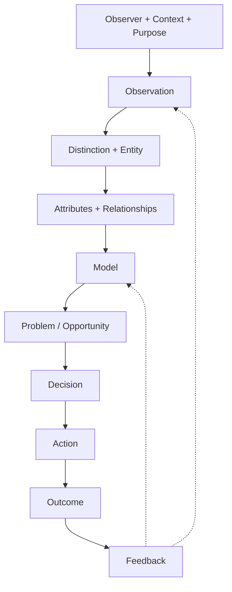

# Foundational Model of Understanding and System Evolution

**ID:** NB-MOD-001  
**Version:** 1.0.0  
**Status:** Proposed; not yet tested or approved  
**Recorded date:** 2026-10-31  
**Exact time:** Not recorded  
**Persian edition:** [فارسی](NB-MOD-001.fa.md)  
**Narrative:** [Chapter One](../book/en/01-the-beginning.md)

## Core Question
How can observation and understanding of a subject lead to a model, decision, action, and learning?

## Scope
This is a proposed model of **purposeful understanding and change from an observer's perspective**. It is not a universal account of existence, human behavior, or the final software architecture of NIKWAY.

## Elements
| Element | Short definition |
|---|---|
| Observer | Person or system receiving or interpreting information |
| Context | Conditions and relationships relevant to meaning |
| Purpose | Reason for studying or changing something |
| Observation | Receiving and recording information |
| Distinction | Recognizing a difference |
| Entity | Subject with a referable identity |
| Attribute | Description of an entity |
| Relationship | Link between entities |
| Model | Purposeful simplified representation |
| Problem | Meaningful gap from a reference state |
| Decision | Choice among options |
| Action | Activity that may change a state |
| Outcome | Observed state or effect following action |
| Feedback | Outcome information used in later understanding or decisions |

## Proposed Relationships
An observer observes within a context and for a purpose. Observation may support distinctions and entity identification. Models represent entities, attributes, and relationships for a given purpose. Models and evidence can inform problem framing and decisions. Decisions may lead to actions and outcomes; feedback may change later observations, models, goals, and choices.

These links are context-dependent, not universal mandatory steps.

## Conceptual View

## Enterprise Example
If 20 of 100 orders are late, on-time delivery is 80%, assuming the measure and period are defined. Against a 95% target, the gap is 15 percentage points. Cause analysis, decisions, and actions require separate records; improved delivery must be verified with later evidence.

## Open Questions
How should identity, context, and purpose be represented? Where is the line between observation and interpretation? How should loops be modeled? Which relationships can be expressed in ArchiMate, KerML, or a knowledge graph?

## Status
This is a starting model for further discussion and testing, not an approved technical kernel.
