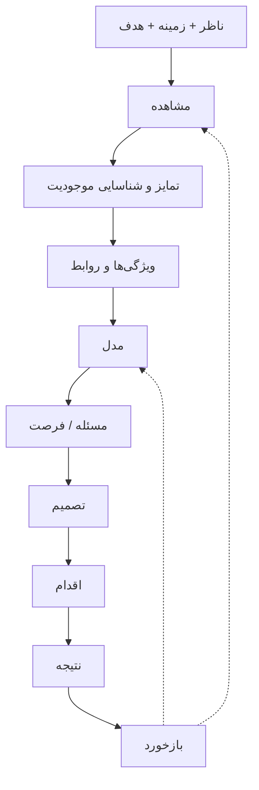

# مدل بنیادین شناخت و تکامل سیستم‌ها

**شناسه:** NB-MOD-001  
**نسخه:** ۱.۰.۰  
**وضعیت:** پیشنهادی؛ هنوز آزموده و تأیید نشده  
**تاریخ ثبت:** ۳۱ اکتبر ۲۰۲۶  
**زمان دقیق:** ثبت نشده  
**متن مرتبط:** [مدل انگلیسی](NB-MOD-001.en.md)  
**روایت:** [فصل اول](../book/fa/01-the-beginning.md)

## پرسش بنیادین
چگونه می‌توان از مشاهده و شناخت یک پدیده، به مدل، تصمیم، اقدام و یادگیری رسید؟

## مرز مدل
این مدل، **فرایند شناخت و تغییر هدفمند** را از دید یک ناظر توصیف می‌کند؛ نه منشأ قطعی جهان، نه همه رفتارهای انسان و نه معماری فنی نهایی نیک‌وی.

## عناصر پیشنهادی
| عنصر | تعریف کوتاه |
|---|---|
| ناظر | فرد یا سامانه‌ای که اطلاعات را دریافت یا تفسیر می‌کند |
| زمینه | شرایط و روابط مؤثر بر تفسیر |
| هدف | مقصود بررسی یا تغییر |
| مشاهده | دریافت و ثبت اطلاعات |
| تمایز | تشخیص تفاوت |
| موجودیت | موضوعی که هویت قابل‌ارجاع دارد |
| ویژگی | توصیف یک موجودیت |
| رابطه | پیوند میان موجودیت‌ها |
| مدل | بازنمایی هدفمند و ساده‌شده |
| مسئله | اختلاف معنادار با یک وضعیت مرجع |
| تصمیم | انتخاب یک گزینه |
| اقدام | انجام کاری که می‌تواند وضعیت را تغییر دهد |
| نتیجه | وضعیت یا پیامد مشاهده‌شده پس از اقدام |
| بازخورد | اطلاعات نتیجه که به شناخت یا تصمیم بعدی بازمی‌گردد |

## روابط پیشنهادی
- ناظر **در زمینه** و **با هدف** مشاهده می‌کند.
- مشاهده می‌تواند به تشخیص تمایز و شناسایی موجودیت‌ها کمک کند.
- موجودیت‌ها ویژگی و رابطه دارند؛ مدل آن‌ها را برای هدفی مشخص بازنمایی می‌کند.
- مدل و شواهد می‌توانند در تشخیص مسئله و تصمیم‌گیری استفاده شوند.
- تصمیم ممکن است به اقدام منجر شود؛ اقدام ممکن است نتیجه‌ای ایجاد کند.
- بازخورد می‌تواند مشاهده، مدل، هدف و تصمیم بعدی را اصلاح کند.

این روابط **احتمالی و زمینه‌مند** هستند؛ هیچ مرحله‌ای برای همه سیستم‌ها الزامی نیست.

## نمای ساده

## مثال بنگاه اقتصادی
در یک کارخانه، ۲۰ سفارش از ۱۰۰ سفارش با تأخیر تحویل شده‌اند. این یک مشاهده با دوره و تعریف شاخص مشخص است. اگر هدف تحویل به‌موقع ۹۵٪ باشد، اختلاف ۱۵ واحد درصدی با عملکرد ۸۰٪ داریم. تحلیل علت، تصمیم و اقدام باید جدا ثبت شوند؛ کاهش تأخیر بدون شواهد بعدی اثبات نمی‌شود.

## پرسش‌های باز
- آیا هویت، زمینه و هدف باید عناصر پایه مدل باشند یا ویژگی‌های یک مدل؟
- مرز میان مشاهده و تفسیر چگونه تعیین می‌شود؟
- آیا حلقه‌ها باید با مدل‌های جداگانه رفتار نمایش داده شوند؟
- چه روابطی در ArchiMate، KerML و گراف دانش قابل‌نمایش‌اند؟

## وضعیت
این مدل، مبنای گفت‌وگو و آزمون‌های بعدی است؛ انتخاب قطعی زبان مدل‌سازی یا هسته اجرایی نیست.
